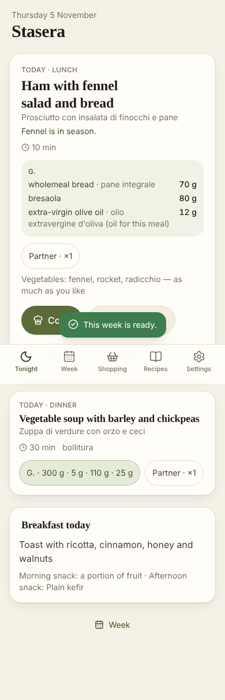

# Stasera

*What's for dinner, to the gram.*

A mobile-first web app (installable PWA) for a two-person household in Sanremo where one person follows
a nutritionist's exchange-based plan ("schema a grammature": fixed gram amounts of a grain, a protein and
oil per meal, vegetables unlimited, with approved substitutions and weekly frequency rules) and the other
eats the same dishes freely.

Every evening it answers one question with a dish that fits the plan to the gram, keeps variety high
over months, and writes one shopping list for the week in supermarket walking order.



## What it does

- **Tonight** — tonight's dish, her plate in the plan's exact grams, the partner's scaled, one line of
  "why today", *Cook / Not tonight / Done*, and tomorrow's lunch to pack.
- **Week** — seven days drafted from the plan's own day templates: locked meals stay, swaps keep the
  lunch–dinner pairing, the free meal moves as a day, weekly counts shown as numbers.
- **Shopping** — packs and drained weights ("2 × lattina 400 g (240 g sgocciolato)"), store walking order,
  a mid-week fresh run, pantry and purchase reconciliation, offline ticking, copy/share.
- **Recipes** — dishes are *shapes* over the plan's slots (no quantities), validated against the plan
  ("Fits Day 5 lunch with the quinoa alternative", "protein slot unfilled", "ask the nutritionist").
- **Settings** — the plan's amounts by day (editable, revisioned), preferences, pantry, questions for the
  nutritionist, JSON export/import, and optional two-phone sync.

Grams are always read from the plan and never computed; an independent checker proves every generated
week against every rule.

## Run it

```bash
pnpm install
pnpm dev            # http://localhost:5173
pnpm check          # typecheck + lint + unit/property tests + build
pnpm test:e2e       # phone-sized Playwright journeys against the production build
pnpm week demo 7    # print a generated week, its rule counts and its shopping list
```

Deployment (static hosting, GitHub Pages workflow, optional Cloudflare Worker for sync): [`docs/DEPLOY.md`](docs/DEPLOY.md).
Product plan and design: [`docs/PLAN.md`](docs/PLAN.md). Build brief and progress: [`docs/BUILD.md`](docs/BUILD.md), [`docs/PROGRESS.md`](docs/PROGRESS.md).

## Layout

```
src/core/     pure domain: model, planner, checker, plates, batches, shopping, validator, mutations
src/data/     foods catalogue (Italian names, pack sizes, seasons), demo plan, seed dish book
src/store/    IndexedDB store, actions, selectors, sync client
src/ui/       React screens and components (TanStack Router, Tailwind 4)
worker/       optional sync service (Cloudflare Workers + D1)
e2e/          Playwright journeys; docs/screenshots are produced by them with demo data
plans/        demo.json (committed); private/ is git-ignored
```

## Privacy

The real nutritionist documents are copyrighted and contain personal data; they are never committed.
The app loads the household's plan from a private file or an in-app import. The repository ships only
`plans/demo.json`, a generic plan with invented values that has the same shape, used for development,
tests and screenshots. Nothing leaves the phone unless the optional sync service is configured.
